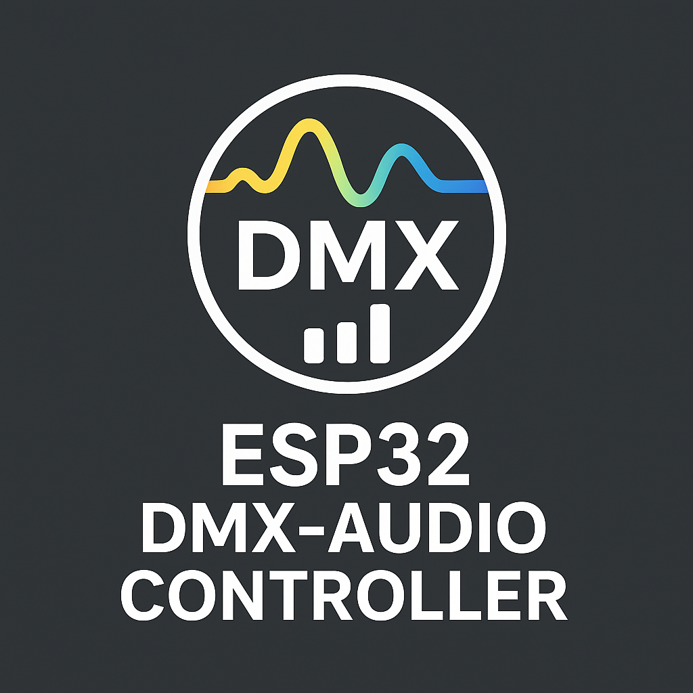

**Deutsch** | [English](Readme.en.md)

# 🎛️ ESP32 DMX Audio‑Reactive Controller

Ein audio‑reaktiver DMX‑Controller auf Basis eines ESP32. Er hört über ein I2S‑Mikrofon mit,
erkennt Beats, Tempo und Drops und steuert damit RGB‑Lampen, PARs, Moving Heads und eine
Nebelmaschine. Bedient wird er komplett über eine Web‑Oberfläche im Browser – am Handy,
Tablet oder PC, auf Deutsch oder Englisch.

Ideal für Partys, Partyräume, kleine Bühnen und Installationen.

---

## 📸 Screenshots

| Startseite | DMX‑Konfiguration |
|---|---|
|  |  |
| **Moving Head** | **Lauflicht‑Editor** |
|  |  |
| **DMX‑Monitor** | **WLAN & Netzwerk** |
|  |  |

---

## 🚀 Funktionen

### 🎵 Audio
- I2S‑Mikrofon (z. B. INMP441), 1024‑Punkte‑FFT
- Erkennung von **Kick, Snare und Hi‑Hat**, BPM aus der Musik
- **Drop‑Erkennung** (Breakdown + kräftiger Kick oder Energiesprung), abschaltbar
- **Tap‑Tempo** und „BPM fest“ – ein interner Takt ersetzt dann die Erkennung
- **Mikrofon einmessen** (Stille + Musik) für saubere Rauschschwellen in jedem Raum
- Live‑**Spektrum** (16 Bänder), Pegel und Beat‑Anzeige in der Web‑Oberfläche

### 💡 Effekte & Show
- **25 Effekte**, u. a. Fade, Rainbow, Chase, Bounce, Fire, Aurora, Strobe, Disco,
  Light Organ sowie die Audio‑Effekte **Pump**, **Snare Flash** und **Bass Wave**
- **Im Takt**: Effekte laufen auf ½, 1 oder 2 Beats pro Schritt
- **Weiche Übergänge** (einstellbar, auch pro Preset), **Breite** und **Intensität** pro Effekt
- **Farbpalette** mit 2–8 eigenen Farben für Chase, Disco, Fade & Co.
- **Gruppen** (bis zu 4) mit eigenem Effekt und eigener Farbe
- **Presets** (bis zu 16) mit Effekt, Farbe, Speed, Master, Gruppen und Palette
- **Auto‑Show**: Presets alle N Beats durchschalten – optional **passend zur Energie der Musik**
- **Cue‑Liste** (bis zu 32 Schritte) für feste Abläufe
- **Drop‑Reaktion**: Strobe, weißer Blitz, Farbexplosion oder Preset – optional mit Nebelstoß
- **Eigene Lauflichter** (4 Plätze, bis 8 Lampen × 16 Schritte) im grafischen Editor
- **Strobe**, **Blackout** und **Nebel** als Live‑Knöpfe
- **Helligkeit folgt Lautstärke**, **Standby** ohne Musik, **Zeitplan** (Uhrzeit per Internet)

### 🔦 Moving Heads
- Joystick‑Steuerung, Bewegungsbereich über Punkt A/B
- **BPM‑Automatik** mit Mustern: Kreis, Acht, Schwenk, Nicken, Zufall – versetzt (Welle) oder synchron
- **Positionen** speichern und anfahren (bis zu 8)
- Zusatzkanäle **Gobo, Farbrad, Prisma, Fokus**

### 🖥️ Bedienung & Einrichtung
- Web‑Oberfläche mit Live‑Bereich und einklappbaren Einstellungen, **Deutsch / Englisch**
- **Virtuelle Bühne**: zeigt live, was an die Lampen gesendet wird
- **DMX‑Monitor** mit **Kanaltest** und „Lampe finden“ (Lampe blinkt)
- **Vorlagen** für typische Fixture‑Belegungen (RGB, RGBW, PAR, Spot, Wash)
- Optionaler **Passwortschutz** für die gesamte Oberfläche
- **OLED‑Display** (IP, BPM, Effekt, Status) mit Einbrennschutz
- **Taster / Fußschalter** für Strobe, Blackout, Nebel, Tap und nächstes Preset

### 🌐 Netzwerk & Integration
- WLAN mit automatischem Hotspot und Wiederverbinden im Hintergrund
- **OTA‑Updates** über die Web‑Oberfläche oder direkt aus PlatformIO
- **Art‑Net / sACN (E1.31)**: Steuerung durch PC‑Lichtsoftware wie QLC+
- **MQTT / Home Assistant** mit automatischer Erkennung (Licht, Preset‑Auswahl, BPM‑Sensor)
- **Mehrere Controller synchron** per ESP‑NOW (Master/Slave)
- **Backup & Wiederherstellung** aller Einstellungen als Datei

---

## 🔌 Hardware

### Komponenten
- ESP32 DevKit (ESP32‑WROOM)
- I2S‑Mikrofon INMP441 (oder ICS‑43434)
- RS485‑Transceiver MAX485 für den DMX‑Ausgang
- optional: 0,96" OLED 128×64 (SSD1306, I2C)
- optional: Taster / Fußschalter

Schaltplan, Platinenlayout und 3D‑Ansichten liegen im Ordner [`PCB/`](PCB/).

### Pinbelegung
| Funktion | GPIO |
|---|---|
| I2S WS (LRCL) | 5 |
| I2S SCK (BCLK) | 18 |
| I2S SD (DOUT) | 19 |
| DMX TX → MAX485 DI | 32 |
| DMX Enable → MAX485 DE/RE | 33 |
| OLED SDA | 22 |
| OLED SCL | 21 |
| Taster Strobe (halten) | 25 |
| Taster Blackout (an/aus) | 26 |
| Taster Nebel (halten) | 27 |
| Taster Tap‑Tempo | 14 |
| Taster nächstes Preset | 13 |

Taster werden jeweils zwischen GPIO und GND angeschlossen (interne Pull‑ups, keine Widerstände nötig).
Das Display bekommt 3,3 V.

---

## 🛠️ Installation

1. Projekt in **VS Code mit PlatformIO** öffnen.
2. ESP32 per USB anschließen und **Upload** ausführen. Das Dateisystem (Web‑Oberfläche)
   wird danach automatisch mit hochgeladen.
3. Beim ersten Start öffnet der ESP32 den Hotspot **`DMX-Controller`** (Passwort `12345678`).
   Damit verbinden und `http://192.168.4.1` öffnen.
4. Auf der Seite **WLAN** das eigene Netzwerk einrichten. Danach ist der Controller unter
   **`http://dmx-controller.local`** oder der IP erreichbar, die das Display anzeigt.
5. Unter **DMX** die Lampen anlegen (Startadresse, Typ, optional Gruppe).
6. Auf der Startseite unter **Audio & Drop** das **Mikrofon einmessen**.

### Updates
- **Web‑Oberfläche:** Seite **Update** (`/update`), Login `admin` / `dmxupdate`.
  Hochgeladen werden `.pio/build/esp32dev/firmware.bin` bzw. `littlefs.bin`.
- **PlatformIO per WLAN:** Umgebung `esp32dev_ota` wählen und **Upload** ausführen.
- Die Einstellungen liegen im NVS‑Speicher und bleiben bei Updates erhalten.

> **Sicherheit:** Die Standard‑Passwörter stehen in [`include/ota.h`](include/ota.h)
> (Update, passend dazu `--auth=` in `platformio.ini`) und [`include/wifi.h`](include/wifi.h)
> (Hotspot). Bitte ändern – und dabei bedenken, dass sie in einem öffentlichen Repo für alle lesbar sind.
> Für die Bedienung lässt sich auf der Seite **WLAN** ein eigenes Passwort setzen.
> **Passwort vergessen?** Beim Einschalten den Tap‑Taster (GPIO 14) gedrückt halten.

---

## 📖 Bedienung im Überblick

| Seite | Inhalt |
|---|---|
| **Home** | Live‑Status, Effekte, Master, Strobe/Blackout/Nebel, Presets; einklappbar: Farbe, Tempo, Audio & Drop, Palette, Gruppen, Automatik, Cue‑Liste, virtuelle Bühne |
| **WLAN** | Netzwerk, Passwortschutz, Synchronisation, MQTT / Home Assistant |
| **DMX** | Fixtures und Fixture‑Typen, Vorlagen, Nebelmaschine, Zeitplan, Display, Taster, Art‑Net/sACN |
| **Moving Head** | Joystick, Punkt A/B, BPM‑Automatik, Bewegungsmuster, Positionen, Gobo & Co. |
| **Lauflicht** | Editor für eigene Lauflichter |
| **Monitor** | Gesendete DMX‑Werte live, Kanaltest, Auslastung der beiden Cores |
| **Update** | Firmware/Dateisystem aktualisieren, Backup & Wiederherstellung |

### Art‑Net / sACN
Auf der Seite **DMX** einschalten und das Universum wählen. Universum 1 entspricht
Art‑Net‑Universum 0 bzw. sACN‑Universum 1 (wie in QLC+ angezeigt). Solange Daten kommen,
steuert der PC die Lampen; 3 s nach dem letzten Paket übernehmen wieder die Effekte.

### MQTT / Home Assistant
Broker auf der Seite **WLAN** eintragen. Home Assistant findet den Controller automatisch als
Licht (an/aus = Blackout, Helligkeit = Master, Farbe, Effekte), Preset‑Auswahl und BPM‑Sensor.

### Mehrere Controller
Auf der Seite **WLAN** einen Controller als **Master**, die anderen als **Slave** einstellen
(gleiche Gruppe, gleiches WLAN). Die Slaves übernehmen Beat, Effekt, Farben und Drops.

---

## 🧩 Projektstruktur

| Datei | Aufgabe |
|---|---|
| `src/main.cpp` | Start, Effekt‑Task, Auto‑Show, Cue‑Liste, Standby, Nebel |
| `src/audio.cpp` | Mikrofon, FFT, Beat‑/Drop‑Erkennung, Einmessen, Spektrum |
| `src/effects.cpp` | Alle Effekte, Palette, Lauflichter, Drop‑Reaktionen |
| `src/dmx.cpp` | DMX‑Ausgabe (eigener Task), Übergänge, Moving‑Head‑Bewegung |
| `src/state.cpp` | Zustand, Speichern/Laden im NVS, Presets, Backup |
| `src/web*.cpp` | Webserver, WebSocket und Web‑API |
| `src/netinput.cpp` | Art‑Net / sACN |
| `src/sync.cpp` / `src/mqtt.cpp` | ESP‑NOW‑Synchronisation / MQTT & Home Assistant |
| `src/display.cpp`, `buttons.cpp`, `schedule.cpp`, `wifi.cpp`, `ota.cpp` | Display, Taster, Zeitplan, WLAN, Updates |
| `data/` | Web‑Oberfläche (HTML, CSS, JavaScript, Übersetzungen) |

Die Arbeit ist auf beide Kerne verteilt: **Core 0** übernimmt WLAN, Audio‑Analyse und Display,
**Core 1** DMX‑Ausgabe, Webserver und Effekte.

### Bibliotheken
SparkFun DMX, arduinoFFT, ESPAsyncWebServer / AsyncTCP, ArduinoJson, Adafruit SSD1306, PubSubClient
